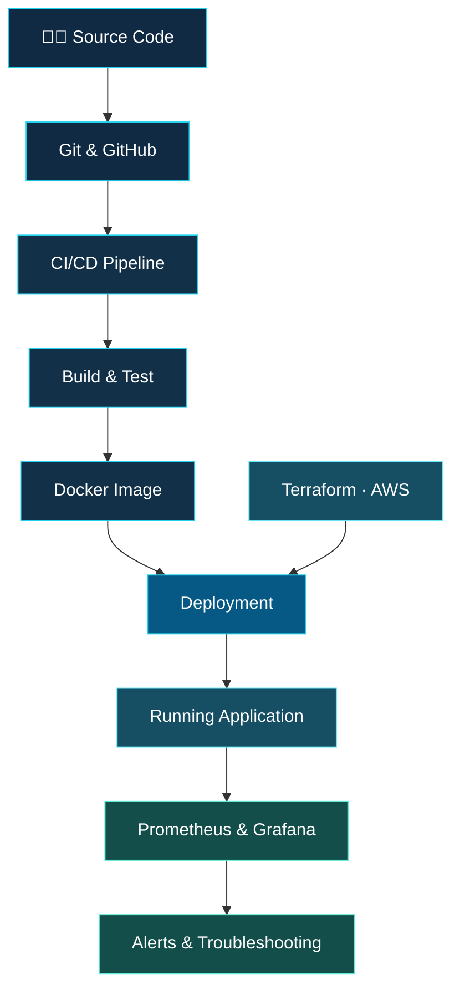

<div align="center">

<a href="https://github.com/Vaibhav-Wasamkar">
  
</a>

<a href="https://readme-typing-svg.demolab.com">
  
</a>

<p>
  <a href="https://www.linkedin.com/in/vaibhavwasamkar"></a>
  <a href="https://github.com/Vaibhav-Wasamkar"></a>
  <a href="mailto:vaibhavwasamkar@gmail.com"></a>
  <a href="Vaibhav_Wasamkar_Resume.pdf"></a>
</p>

**Cloud Infrastructure · Infrastructure as Code · CI/CD · Containers · Observability**

*Turning infrastructure requirements into automated, repeatable, and observable deployments.*

</div>

---

## `$ whoami`

I'm an **Associate DevOps Engineer at TechnoPath**, with experience spanning AWS infrastructure, Infrastructure as Code, CI/CD automation, containerization, Linux administration, and monitoring.

I started my professional journey as a DevOps Intern in July 2024 and progressed to a full-time Associate DevOps Engineer role in July 2025.

I enjoy understanding how systems work end to end—from provisioning cloud resources and automating application delivery to troubleshooting failures and monitoring system health.

```bash
$ whoami
Associate DevOps Engineer

$ cat /etc/engineering-focus
AWS | Terraform | Jenkins | Docker | Linux
CI/CD | Prometheus | Grafana | Cloud Automation

$ echo $CURRENT_GOAL
Build reliable infrastructure and improve deployment automation
```

<div align="center">

| <h2>☁️ Cloud</h2> | <h2>🏗️ Infrastructure</h2> | <h2>🚀 Delivery</h2> | <h2>📈 Observability</h2> |
|:---:|:---:|:---:|:---:|
| <h3>AWS</h3> | <h3>Terraform</h3> | <h3>Jenkins</h3> | <h3>Prometheus</h3> |
| <h3>Azure Cloud</h3> | <h3>CloudFormation</h3> | <h3>Docker</h3> | <h3>Grafana</h3> |

</div>

---

## 🧭 Engineering portfolio

These projects demonstrate different parts of my DevOps workflow: infrastructure provisioning, automated delivery, and operational visibility.

<table>
<tr>
<td width="50%" valign="top">

<h3>☁️ AWS 3-Tier Infrastructure</h3>

<a href="https://github.com/Vaibhav-Wasamkar/AWS_3-Tier_Infrastructure">
  
</a>

A Terraform-based infrastructure project organized around network, application, and database tiers.

**Engineering highlights**
- Custom VPC and public/private subnets
- Internet and NAT gateways, route tables, and security groups
- EC2 instances behind an Application Load Balancer
- Auto Scaling and private RDS placement
- Reusable Terraform modules

**Stack:** AWS · Terraform · VPC · EC2 · ALB · RDS

<p>
  <a href="https://github.com/Vaibhav-Wasamkar/AWS_3-Tier_Infrastructure">
    
  </a>
</p>

</td>
<td width="50%" valign="top">

<h3>⚙️ CI/CD Pipeline Automation</h3>

<a href="https://github.com/Vaibhav-Wasamkar/CI-CD-Pipeline-Automation">
  
</a>

A deployment workflow focused on reducing manual steps between source code and application delivery.

**Engineering highlights**
- Source-code checkout and test stages
- Docker image build and deployment workflow
- GitHub integration
- Terraform-based AWS infrastructure provisioning
- Automated, repeatable pipeline execution

**Stack:** Jenkins · GitHub · Docker · Terraform

<p>
  <a href="https://github.com/Vaibhav-Wasamkar/CI-CD-Pipeline-Automation">
    
  </a>
</p>

</td>
</tr>
<tr>
<td width="50%" valign="top">

<h3>📊 Cloud Monitoring & Observability</h3>

<a href="https://github.com/Vaibhav-Wasamkar/Cloud-Monitoring-Observability-Platform">
  
</a>

A monitoring setup for observing infrastructure health, visualizing resource metrics, and configuring alerts.

**Engineering highlights**
- Prometheus metrics collection
- Grafana dashboards
- Alertmanager notification routing
- CPU, memory, disk, network, and service monitoring
- Linux and AWS EC2 monitoring

**Stack:** Prometheus · Grafana · Alertmanager · Linux · AWS

<p>
  <a href="https://github.com/Vaibhav-Wasamkar/Cloud-Monitoring-Observability-Platform">
    
  </a>
</p>

</td>
<td width="50%" valign="top">

<h3>🗄️ Terraform Remote State Lab</h3>

<a href="https://github.com/Vaibhav-Wasamkar/Terraform-Remote-State-Lab">
  
</a>

A focused lab for exploring Terraform state management and the foundations of collaborative infrastructure workflows.

**Explore concepts such as**
- Terraform state and its purpose
- Remote state configuration
- State consistency and collaboration
- Infrastructure lifecycle management
- State locking and concurrent execution protection

**Stack:** Terraform · AWS · Infrastructure as Code

<p>
  <a href="https://github.com/Vaibhav-Wasamkar/Terraform-Remote-State-Lab">
    
  </a>
</p>

</td>
</tr>
</table>

---

## 🔄 How I think about DevOps

The goal is to connect code changes to reliable deployments while making the resulting systems observable.



*Conceptual workflow: the exact pipeline stages and deployment targets depend on the project.*

---

## 🧰 Technology stack

<div align="center">

### Cloud platforms

<a href="https://aws.amazon.com/"></a>
<a href="https://azure.microsoft.com/"></a>

### Infrastructure as Code

<a href="https://www.terraform.io/"></a>
<a href="https://aws.amazon.com/cloudformation/"></a>

### CI/CD, version control & containers

<a href="https://www.jenkins.io/"></a>
<a href="https://github.com/features/actions"></a>
<a href="https://git-scm.com/"></a>
<a href="https://github.com/"></a>
<a href="https://www.docker.com/"></a>
<a href="https://kubernetes.io/"></a>

### Monitoring & observability

<a href="https://prometheus.io/"></a>
<a href="https://grafana.com/"></a>
<a href="https://www.gnu.org/software/bash/"></a>

### Operating systems & scripting

<a href="https://www.linux.org/"></a>
<a href="https://ubuntu.com/"></a>
<a href="https://www.python.org/"></a>

</div>

<details>
<summary><strong>☁️ AWS services I work with</strong></summary>

EC2 · VPC · IAM · Application Load Balancer · Auto Scaling · S3 · RDS · ECR · ECS · EKS · CloudFront · CloudWatch · Route 53

</details>

<details>
<summary><strong>🛠️ Additional tools and technologies</strong></summary>

Docker Compose · Node Exporter · Alertmanager · Bash/Shell scripting · YAML · Windows · WSL · Java

</details>

---

## 💼 Professional experience

### Associate DevOps Engineer — TechnoPath

**July 2024 – Present**

Progressed from an DevOps Intern to a full-time Associate DevOps Engineer role in July 2025.

- Provision and manage AWS cloud infrastructure using Terraform and Infrastructure as Code practices.
- Build and maintain CI/CD pipelines using Jenkins and GitHub Actions for application build, testing, and deployment workflows.
- Containerize applications with Docker and Docker Compose.
- Implement monitoring dashboards and alerting with Prometheus, Grafana, and Alertmanager.
- Troubleshoot Linux systems and cloud infrastructure using logs, metrics, and service diagnostics.
- Support automation, version control, and deployment workflows using Git, GitHub, and Bash.

---

## 🎓 Education Qualification

**B.Tech — Cloud Technology and Information Security**  
Ajeenkya D Y Patil University · 2021 – 2025

- **CGPA:** 9.08
- **Achievement:** Secured 2nd rank in the specialization among the graduating batch.

---

## 🧪 Current learning focus

I'm continuing to deepen my practical understanding of cloud-native infrastructure and modern deployment workflows.

- **Kubernetes:** Workloads, services, configuration, probes, rollouts, and troubleshooting
- **Amazon EKS:** Managed Kubernetes infrastructure on AWS
- **GitOps:** Argo CD, declarative deployments, and synchronization strategies
- **Reliability:** Monitoring, alerting, resource utilization, and systematic troubleshooting

I aim to turn each learning topic into a practical lab or documented implementation wherever possible.

---

## 🌐 Connect & Collaborate

I'm always interested in exchanging ideas, exploring cloud technologies, and learning how engineering teams build and operate reliable infrastructure.

Whether it's AWS, Infrastructure as Code, CI/CD automation, or cloud-native technologies, I'm open to connecting with fellow engineers and professionals.

<p align="center">
  <a href="https://www.linkedin.com/in/vaibhavwasamkar"></a>
  <a href="mailto:vaibhavwasamkar@gmail.com"></a>
</p>

<div align="center">


</div>
